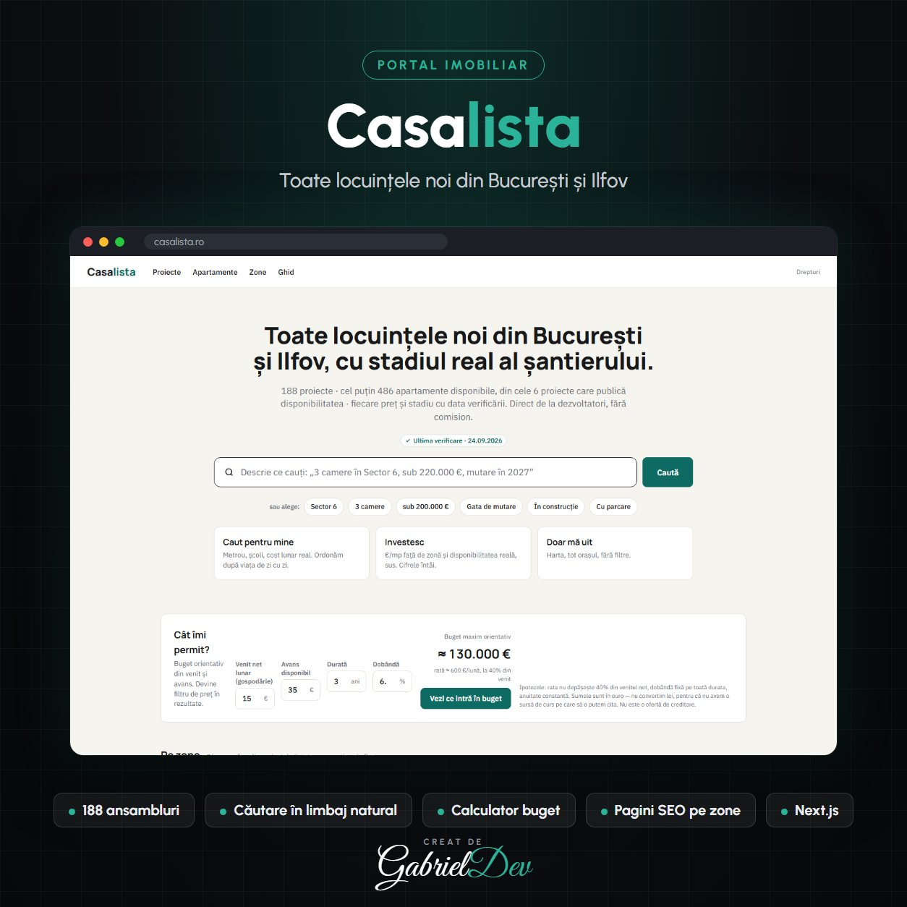

  

<h1 align="center">Casalista – Portal cu Toate Locuințele Noi din București și Ilfov</h1>

Portal imobiliar cu toate ansamblurile rezidențiale noi din București și Ilfov, cu stadiul real al șantierului, căutare în limbaj natural, calculator de buget și pagini SEO pe zone.

| | |
|---|---|
| **Client** | Client privat |
| **An** | 2026 |
| **Domeniu** | Backend Development · Frontend Development · Aplicații Web Personalizate |
| **Status** | Live — [casalista.ro](https://casalista.ro) |
| **Studiu de caz** | [gabrieldev.eu](https://gabrieldev.eu/portofoliu/casalista-portal-locuinte-noi-bucuresti-ilfov) |

---

## Toate locuințele noi, într-un singur loc, cu date verificate

Casalista adună **toate ansamblurile rezidențiale noi din București și Ilfov** (peste 180 de proiecte) și arată pentru fiecare stadiul real al șantierului, termenul de livrare și data la care a fost verificată fiecare cifră. Cumpărătorul ajunge direct la dezvoltator, fără comision.

## Funcționalități implementate

- **Căutare în limbaj natural**: scrii „3 camere în Sector 6, sub 220.000 &euro;, mutare în 2027” și primești rezultatele potrivite
- Filtre rapide: sector, număr de camere, buget, gata de mutare, în construcție, parcare
- Trei moduri de căutare: pentru locuit (metrou, școli, cost lunar), pentru investiție (&euro;/mp față de zonă) și explorare pe hartă
- **Calculator „Cât îmi permit?”**: buget orientativ din venit, avans, durată și dobândă, transformat direct în filtru de preț
- Statistici pe zone: preț median pe metru pătrat, cu mărimea eșantionului afișată
- Ghiduri pentru cumpărători și pagină despre drepturile cumpărătorului
- Date cu sursă și dată de verificare pentru fiecare preț și stadiu

## SEO programatic

- Pagini generate automat pentru fiecare sector, cartier și oraș din Ilfov
- Liste tematice indexabile: „Predare în 2026”, „Lângă metrou”, „În construcție – Sectorul 1” etc.
- Pagină dedicată pentru fiecare ansamblu, cu date structurate și URL-uri curate
- Randare pe server (Next.js) pentru pagini rapide și ușor de indexat de Google

## Tehnologii utilizate

- Next.js, React, TypeScript
- Randare pe server și generare statică
- Bază de date cu proiecte, apartamente, zone și istoric de verificări
- Git pentru versionare și deploy controlat

## Rezultatul

Un portal imobiliar construit pentru încredere și pentru trafic organic: fiecare zonă și fiecare listă devine o pagină care poate apărea în Google, iar cumpărătorul vede date reale, nu doar reclame.

---

## 🔒 Despre cod

Acesta este un repository de **prezentare**. Codul sursă aparține clientului și nu este public — aici găsești descrierea proiectului, funcționalitățile și tehnologiile folosite.

## 🤝 Ai nevoie de ceva asemănător?

Proiect realizat de **[Gabriel Dev](https://gabrieldev.eu)** — creare site-uri, magazine online și aplicații web personalizate.

- 🌐 [gabrieldev.eu](https://gabrieldev.eu) · [toate proiectele](https://gabrieldev.eu/proiecte)
- ✉️ [contact@gabrieldev.eu](mailto:contact@gabrieldev.eu)
- 📞 [+40 743 543 100](tel:+40743543100)
